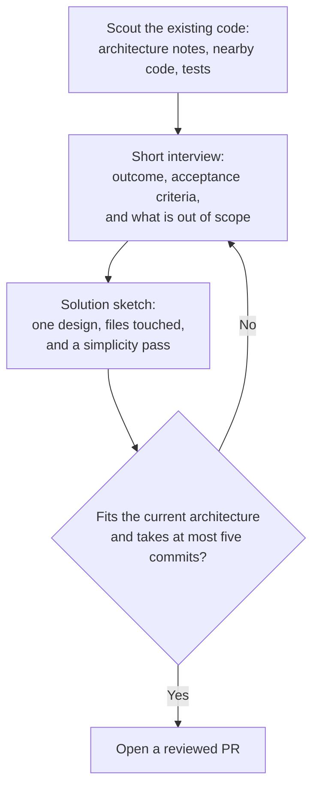

# A quiet place to read

This folder is a sample workspace. Open it with the terminal viewer or the desktop app and the notes render in place, including the diagrams.

The desktop app draws Mermaid with the same engine VS Code uses. The terminal draws the common diagram types with box characters, and a wide diagram can be panned sideways.

## The flow



Keep the change small enough to review in one sitting. If the answer is no, go back to the interview instead of inventing a second design.


## What to open next

- [A conversation between editor and preview](docs/sequence.md)
- [Charts, a timeline, and a small plan](docs/charts.md)
- [Classes, states, and an entity sketch](docs/models.md)

| File | What it shows |
| --- | --- |
| README.md | A top-down flowchart |
| docs/sequence.md | A sequence diagram |
| docs/charts.md | Pie, bar, journey, gantt |
| docs/models.md | Class, state, and ER diagrams |

```ts
const viewer = {
  terminal: "box drawing",
  desktop: "mermaid",
}
```

> Source stays read-only for now. Preview is the default.
